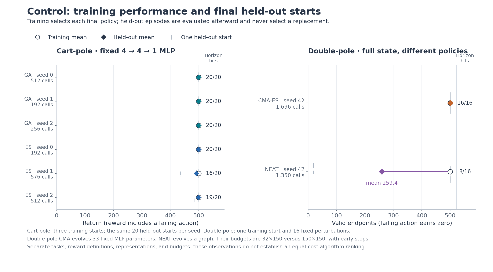

# nevo

Composable neuroevolution in Rust: **Generate → Evaluate → Select**.

`select` incorporates evaluated results and chooses the next search state. It
can retain parents, adapt a distribution, preserve a Pareto front, or manage
species. The same two core traits support vectors, evolving graphs, seed
histories, and user-defined evaluation records.

This repository contains the library, original book companion, and Rust
notebooks together. **Chapters 1–3** now provide executable companions to
[*Neuroevolution: Harnessing Creativity in AI Agent Design*](https://neuroevolutionbook.com/).
The supplied full PDFs were reviewed on 2026-11-24; see the
[source audit](book/source-audit-ch01-ch03.md) and [coverage](coverage.md) for
implemented variants and remaining scope.
These are independently written teaching implementations with real results,
not official exercise solutions or research-benchmark reproductions.

## Additions after reading the PDFs

```sh
cargo run -p nevo --example ch01_population --locked -- results/ch01_population
cargo run -p nevo --example ch02_pdf_updates --release --locked -- results/pdf_review
```

The first example applies Chapter 1's 100/20/80 population structure. The second
runs differential evolution and fixed-scale comma/plus ES on Sphere, and shows
max pooling, stable softmax and multi-head attention. Existing defaults and the
previous experiment records are retained. See [the new run records](book/results/pdf_review/README.md).

## Explore Chapter 3

From the repository root:

```sh
cargo run -p nevo --example ch03_neat --release --locked -- book/results/ch03
cargo run -p nevo --example ch03_classification --release --locked -- book/results/ch03
cargo run -p nevo --example ch03_cartpole --release --locked -- book/results/ch03
cargo run -p nevo --example ch03_doublepole --release --locked -- book/results/ch03
cargo run -p nevo --example ch03_walker --release --locked -- book/results/ch03
cargo run -p nevo --example ch03_parallel --features parallel --release --locked -- book/results/ch03
```

| Example | What it makes inspectable |
| --- | --- |
| `ch03_neat` | Topology growth on XOR, ten declared seeds, successful and failed runs. |
| `ch03_classification` | GA/ES/NEAT on genuine 8×8 Optdigits data, disjoint training/validation/test partitions. |
| `ch03_cartpole` | Fixed-topology GA/ES policies, repeated training starts and held-out episodes. |
| `ch03_doublepole` | Fixed-topology CMA-ES and feedforward NEAT; training success versus generalization. |
| `ch03_walker` | An original spring/contact robot, displacement/work accounting, and actual motion traces. |
| `ch03_parallel` | Seed-encoded deep MLP weights and exact serial/one-worker/four-worker replay. |

The workspace pins **Rust 1.85.1** and dependency versions through `Cargo.lock`.
After the toolchain and crates are cached, add `--offline` for a network-free
build. The attributed Optdigits CSV is bundled; the examples do not download
data. All search, neural computation and environment simulation are Rust.

## Small public API

```rust
use nevo::algorithms::{Neat, NeatConfig};
use nevo::tasks::NeatXor;
use nevo::step;

fn main() -> Result<(), Box<dyn std::error::Error>> {
    let mut search = Neat::new(NeatConfig::new(2, 1, 1))?;
    let mut problem = NeatXor;

    for _ in 0..300 {
        step(&mut search, &mut problem)?;
        let genome = &search.best().unwrap().job.input;
        let predictions = problem.predictions(genome)?;
        let targets = [0.0, 1.0, 1.0, 0.0];
        if predictions.iter().zip(targets).all(|(a, b)| (a - b).abs() <= 0.1) {
            break;
        }
    }

    let best = search.best().unwrap();
    println!("Fitness: {}, hidden nodes: {}", best.output,
        best.job.input.hidden_node_count());
    println!("Fitness calls: {}", search.evaluations());
    Ok(())
}
```

`step` generates a batch, evaluates every job, and calls `select` once. Control
that loop directly when needed. `Algorithm::Input` remains generic;
`neat::Genome` is one concrete graph representation, not a required genome
trait. No mandatory tensor type, simulation framework, `Send`, or `Sync` bound
was added to the core.

Enable `parallel` to use `nevo::execution::step_parallel(&mut search, factory)`.
The factory constructs a fresh evaluator inside each job. Results reach
`select` in submission order; the caller controls the Rayon pool. Transport
bounds apply at this execution boundary, not to every library user.

## Implemented building blocks

| Area | Public API and specified scope |
| --- | --- |
| Genetic algorithm | `Ga`: tournaments, optional top-parent pool, uniform crossover, Gaussian mutation, reevaluated elites. |
| Evolution strategy | `Es`: comma/plus survival and fixed/self-adaptive isotropic Gaussian scale. |
| Differential evolution | `De`: synchronous rand/1/bin mutation, forced crossover and strict target/trial survival. |
| Covariance adaptation | `CmaEs`: classic non-active, positive-weight, full-covariance CMA-ES. |
| Perturbation gradient | `OpenAiEs`: mirrored Gaussian sampling, raw/centered-rank rewards, explicit SGD. |
| Multiobjective evolution | `Nsga2`: rank/crowding survival and mating, uniform/Gaussian box-bounded variation. |
| Topology evolution | `Neat`: historical alignment, structural mutation, compatibility species and shared-fitness quotas; feedforward only. |
| Mutation-only deep GA | `DeepGa`: top-parent truncation, dense Gaussian mutations, seed lineages and reevaluated elites. |
| Reusable evolution components | Tournament/crossover/mutation, Pareto sorting/crowding, graph genes, innovations, compatibility and quota allocation. |
| Neural computation | MLP with analytic MSE gradients; RNN/LSTM, convolution, max pooling, softmax and single/multi-head attention forward components. |
| Classification | Validated labelled data, reproducible stratified splits, MLP/NEAT classifiers and XOR evaluators. |
| Headless control | CartPole, DoublePole, original SpringWalker, explicit state/reset and recorded rollouts. |
| Execution/encoding | Checked serial GES, optional ordered Rayon execution, reproducible seed decoding. |

Only the MLP implements backpropagation. NEAT is currently a feedforward DAG
variant with explicit nonnegative maximizing fitness. Scalar MLP classification
and control tasks minimize their losses; transformations are visible in each
adapter. `nevo-core` remains standard-library-only. `nevo` uses pinned ChaCha and
nalgebra dependencies, plus optional Rayon.

Burn/Bevy adapters, tensor batching, SIMD, GPU/distributed execution, recurrent
NEAT, and general automatic differentiation remain future work. The headless
physics and scalar neural modules establish reference behavior for those
integrations. SpringWalker is not Gym's articulated BipedalWalker.

## Read and explore

- [Chapter 3: neuroevolution](book/ch03_neuroevolution.md)
- [Chapter 3 executed Rust notebook](notebooks/ch03_neuroevolution.ipynb)
- [Chapter 3 results, failures, configurations and plots](book/results/ch03/README.md)
- [Chapter 2: evolutionary and neural foundations](book/ch02_foundations.md)
- [Chapter 1: neural controller introduction](book/ch01_introduction.md)
- [Notebook setup](notebooks/README.md)
- [Design](DESIGN.md), [coverage](coverage.md), and [validation](VALIDATION.md)



The saved results include unsuccessful runs and generalization failures. NEAT
solved XOR in 7/10 seeds within the declared cap. Both double-pole controllers
solved their training start; the selected NEAT controller reached 8/16 held-out
horizons. The spring controller learned asymmetric bounding and failed on
lower-friction ground. Interpret these as documented experiments, not universal
algorithm rankings. Every result has a manifest and raw CSV data.

Earlier examples remain available:

```sh
cargo run -p nevo --example sphere --locked
cargo run -p nevo --example ch01_introduction --locked
cargo run -p nevo --example ch02_search --release --locked -- book/results/ch02
cargo run -p nevo --example ch02_xor --release --locked -- book/results/ch02
cargo run -p nevo --example ch02_neural --locked
```

## Repository map

| Location | Contents |
| --- | --- |
| `crates/nevo-core/` | Two traits, jobs/results, serial execution and protocol tests. |
| `crates/nevo/src/algorithms/` | Stateful search methods through GES. |
| `crates/nevo/src/neat/`, `encoding.rs` | Graph and seed representations plus reusable operations. |
| `crates/nevo/src/nn/` | Scalar neural reference implementations. |
| `crates/nevo/src/control/`, `tasks/`, `benchmarks/` | Headless worlds and evaluators independent of search. |
| `crates/nevo/src/execution.rs` | Optional CPU parallel execution. |
| `crates/nevo/examples/` | Reproducible CLI experiments using the public API. |
| `data/` | Attributed Optdigits subset, source and checksum. |
| `book/`, `notebooks/` | Original explanations, saved outputs and literate Rust. |

## Development and publication

```sh
cargo fmt --all -- --check
cargo clippy --workspace --all-targets --all-features --locked -- -D warnings
cargo test --workspace --locked
cargo test --workspace --all-features --locked
cargo test --workspace --all-features --release --locked
cargo doc --workspace --all-features --no-deps --locked
```

GitHub Actions is configured for Linux and Windows. [VALIDATION.md](VALIDATION.md)
records checks actually run locally; remote CI runs after pushing.
[PUBLISHING.md](PUBLISHING.md) describes first-push and existing-repository use.
The archive has no credentials or preconfigured remote repository.

Inspired by the book by Sebastian Risi, Yujin Tang, David Ha, and Risto
Miikkulainen. This project is not affiliated with its authors or publisher.
The current scope was checked against the supplied full Chapters 1–3; the
original milestone also used public teaching materials and primary method references.
No textbook text or official exercise solutions are redistributed.

The project source-code license remains unselected and `publish = false`.
Dependencies retain their own licenses. The bundled Optdigits data has separate
[CC BY 4.0 attribution](data/README.md).
