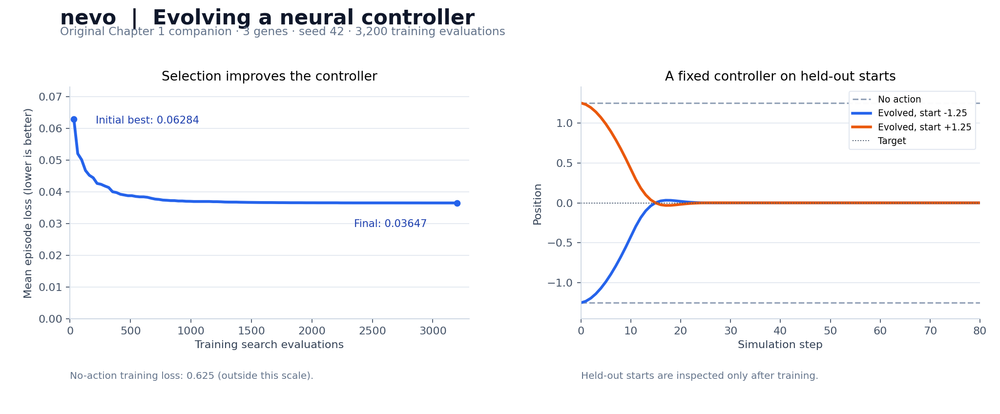

# nevo

Composable neuroevolution in Rust: **Generate → Evaluate → Select**.

`select` incorporates evaluated results and chooses the next search state.
It can select survivors, revise an archive, adapt a search distribution, or
change agent–environment assignments.

This first runnable milestone contains an original Chapter 1 companion to
[*Neuroevolution: Harnessing Creativity in AI Agent Design*](https://neuroevolutionbook.com/):
evolve a three-parameter neural controller that moves a point toward a target.
The official programming assignments begin in Chapter 2; this is an independent
teaching example, not an official exercise solution or a full textbook port.

## Run the example

From the repository root, with Rust installed:

```sh
cargo run -p nevo --example ch01_introduction --locked
```

To also write learning history and trajectories as CSV:

```sh
cargo run -p nevo --example ch01_introduction --locked -- results/ch01
```

The project pins Rust **1.85.1**. Rustup installs the selected toolchain on first
use if necessary. Cargo downloads the pinned RNG dependency and its transitive
dependencies on the first build. After caching the toolchain and dependencies,
the example can run with `--offline`.

## Small public API

```rust
use nevo::algorithms::{ElitistConfig, ElitistSearch};
use nevo::tasks::TargetReach;
use nevo::step;

fn main() -> Result<(), Box<dyn std::error::Error>> {
    let mut task = TargetReach::default();
    let config = ElitistConfig::new(TargetReach::PARAMETERS, 42);
    let mut search = ElitistSearch::new(config)?;

    for _ in 0..100 {
        step(&mut search, &mut task)?;
    }

    if let Some(best) = search.best() {
        println!("Loss: {}", best.output);
        println!("Controller weights: {:?}", best.job.input);
    }
    Ok(())
}
```

The default configuration minimizes the raw objective, evaluates 32 candidates
per batch, and includes initialization in the 100 batches. This is 3,200 training
search evaluations. Each evaluates four 80-step episodes. The retained
incumbent is not evaluated again; this optimizer is for deterministic fitness.

`step()` calls `generate()`, evaluates all jobs, and calls `select()` with the
complete results. Users can implement either core trait or control that loop
themselves. No user genome must implement a `Genome` trait.

`ElitistSearch` uses uniform mutations and retains one incumbent. It is a teaching
algorithm with `(1 + lambda)` elitism, not a canonical GA or Gaussian ES. Its
config exposes dimensions, population size, initialization bound, mutation
scale, objective direction, and seed.

## What the recorded run shows

On the recorded Linux/Rust 1.85.1 run with seed 42:

| Measurement | Loss, lower is better |
| --- | ---: |
| No-action controller on training starts | 0.625000000 |
| Best controller in the initial random batch | 0.062843333 |
| Evolved controller after 3,200 search evaluations | 0.036473747 |
| Evolved controller on four held-out starts | 0.070859762 |

These are results for one small, specified demonstration. The held-out starts
have different initial distances, so their raw loss is not directly comparable
to training loss. They were not used for selection. This is not evidence of
general performance across tasks or seeds.



See [recorded data](book/results/ch01/), [the walkthrough](book/ch01_introduction.md),
and [validation status](VALIDATION.md).

## Explore in a Rust notebook

Open [notebooks/ch01_introduction.ipynb](notebooks/ch01_introduction.ipynb) with
Jupyter and the Rust/Evcxr kernel. It uses the same library and renders learning
and trajectory plots with Plotters. See [setup instructions](notebooks/README.md).
Notebook tools and plotting dependencies are separate from the library.

## Repository map

| Location | Contents |
| --- | --- |
| [DESIGN.md](DESIGN.md) | Accepted GES API and protocol semantics. |
| [coverage.md](coverage.md) | Verified scope and remaining work. |
| `crates/nevo-core/` | Two traits, job/result types, serial runner and tests. |
| `crates/nevo/src/algorithms/` | Reusable uniform-mutation elitist search. |
| `crates/nevo/src/tasks/` | Neural controller and target-reaching environment. |
| `crates/nevo/src/benchmarks/` | Checked Sphere numerical reference. |
| `crates/nevo/examples/` | Executable examples. |
| `book/`, `notebooks/` | Explanations, notebooks, and example data. |

The existing Sphere probe remains available:

```sh
cargo run -p nevo --example sphere --locked
```

## Development checks

```sh
cargo fmt --all -- --check
cargo clippy --workspace --all-targets --locked -- -D warnings
cargo test --workspace --locked
cargo test --workspace --release --locked
cargo doc --workspace --no-deps --locked
```

GitHub Actions runs Cargo checks and both examples on Linux and Windows.
See `VALIDATION.md` for the checks performed locally. GitHub Actions itself
runs after you push the repository.

## Attribution and publication

Inspired by the book by Sebastian Risi, Yujin Tang, David Ha, and Risto
Miikkulainen. The explanations and teaching code here are independently written;
no textbook prose, figures, or official exercise solutions are included. This
project is not affiliated with or endorsed by the book's authors or publisher.

`nevo-core` uses only the standard library. `nevo` adds the pinned Rust ChaCha
RNG; see `Cargo.lock` for resolved dependencies and their own license metadata.
Burn and Bevy integration are planned, not implemented in this milestone.

The project source-code license is not yet selected, and `publish = false`
prevents accidental crates.io publication. No crates.io name reservation is
claimed. GitHub repository creation and pushing remain under your control.
