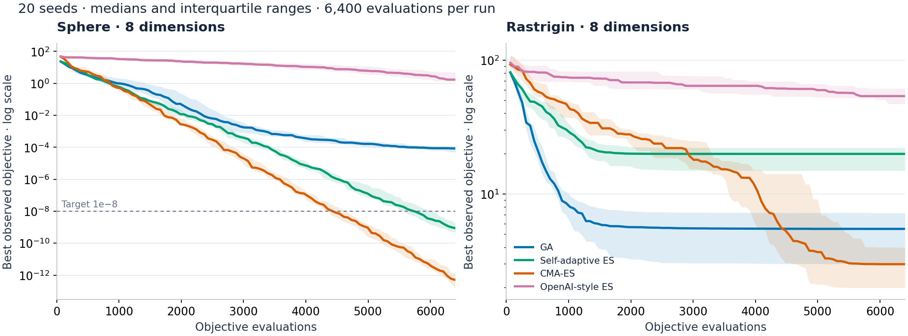
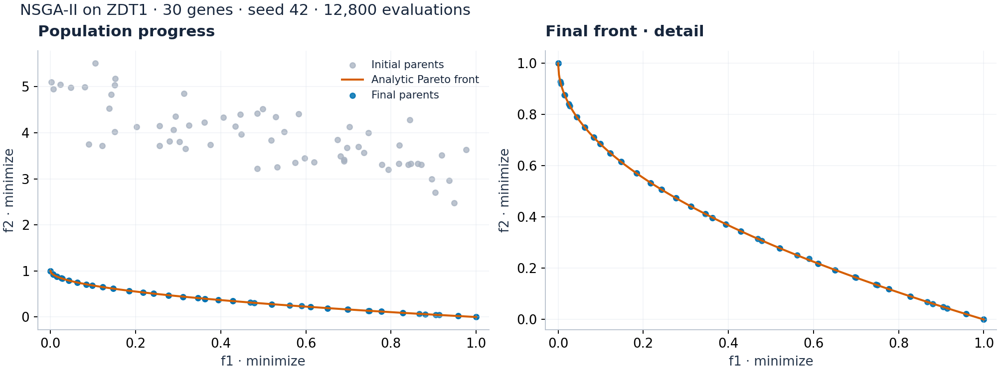
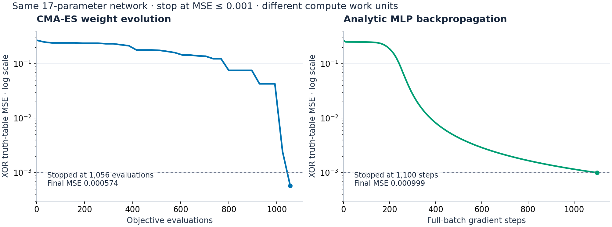

# Chapter 2 · Recorded results

Run on 2026-11-19 using Linux x86_64, Rust 1.85.1, the repository lockfile, scalar `f64` evaluation, and serial GES execution. These are original teaching experiments, not replications of a published experimental protocol.

## Reproduce the numerical data

```sh
cargo run -p nevo --example ch02_search --release --locked -- book/results/ch02
cargo run -p nevo --example ch02_xor --release --locked -- book/results/ch02
cargo run -p nevo --example ch02_neural --locked
```

The [Rust notebook](../../../notebooks/ch02_foundations.ipynb) executes live searches, reads the recorded multi-seed CSV, and draws its figures using Plotters. The PNGs below are static summaries of these committed numerical records.

## Scalar search: common objective-call budgets

Each algorithm uses 8 genes, 64 objective evaluations per batch, 100 batches including initialization, and seeds 0–19: **6,400 evaluations per run**. All runs finish the full budget; the target `1e-8` is recorded without early stopping. The result is the best actually evaluated candidate, never a free evaluation of a distribution mean.

GA and ES start from exactly the same uniform `[-5,5)` population. CMA-ES and OpenAI-style ES share a uniform `[-5,5)` initial mean drawn on independent ChaCha8 stream 2, then sample a Gaussian with sigma 0.5 using their stream 0. Their initial distributions therefore differ from GA/ES. Evaluation seeds use stream 1; mirrored OpenAI pairs deliberately share a trial seed. Full settings are in [search_manifest.json](search_manifest.json).

Quartiles below use linear interpolation at sample positions `p × (n−1)` after sorting. Shaded bands in the figure are interquartile ranges, not confidence intervals.

| Problem | Method | Median final objective | Q1–Q3 | Target hits | Median first-hit evaluations, successful runs only |
| --- | --- | ---: | --- | ---: | ---: |
| Sphere | GA | 8.36575e-05 | 4.94485e-05–0.000116055 | 0/20 | — |
| Sphere | Self-adaptive ES | 8.69707e-10 | 4.45031e-10–1.78217e-09 | 19/20 | 5,734 |
| Sphere | CMA-ES | 5.04538e-13 | 1.62698e-13–1.21168e-12 | 20/20 | 4,416 |
| Sphere | OpenAI-style ES | 1.69518 | 1.31218–4.8025 | 0/20 | — |
| Rastrigin | GA | 5.47814 | 2.99673–7.22265 | 0/20 | — |
| Rastrigin | Self-adaptive ES | 19.8991 | 14.9244–22.1378 | 0/20 | — |
| Rastrigin | CMA-ES | 2.98496 | 1.98992–3.97994 | 0/20 | — |
| Rastrigin | OpenAI-style ES | 53.7675 | 47.0431–61.3675 | 0/20 | — |



The self-adaptive ES reaches the Sphere target in 19 of 20 runs; CMA-ES reaches it in all 20. Rastrigin changes the picture: no method reaches the target within this budget. The GA has a lower median Rastrigin error than the self-adaptive ES despite the opposite ordering on Sphere. These observations concern the recorded configurations only.

OpenAI-style ES uses fixed sigma 0.5, learning rate 0.1, centered average-tie ranks and plain SGD. Its settings were not tuned against these problems. Fixed perturbation noise and reporting the best sampled candidate differ from measuring convergence of its mean. Equal objective counts do not equal identical computational costs: full-covariance CMA-ES also performs matrix factorization.

## Multiobjective search: ZDT1

NSGA-II uses the original **30-gene** ZDT1 form, seed 42, 64 parents, 64 new offspring per subsequent batch, and 200 batches including initialization: **12,800 evaluations**. Parent scores are cached. The implementation uses uniform crossover and Gaussian mutation with clipping to `[0,1]`; its survival and mating use nondominated rank and crowding.

After the recorded run, all 64 selected parents are nondominated within that population. Their mean vertical gap above `f2 = 1 − sqrt(f1)` is **9.464360436e-5**. This diagnostic measures vertical error at the returned first-objective values; it is not hypervolume, a coverage metric, or a multiple-seed performance claim. The plot also shows the represented span.



## Neuroevolution integration: XOR

The network has 2 inputs, 4 tanh hidden units, 1 sigmoid output, and 17 evolvable weights/biases. Both methods begin from the same mean parameter vector, generated uniformly in `[-0.5,0.5)` using seed 42 and independent stream 2. MSE is calculated over all four truth-table rows. Initial loss is **0.2687971233**.

Both runs stop when MSE is at most **0.001**, with a cap of 400 CMA batches of 32 candidates or 5,000 full-batch gradient steps. This explicit stopping rule prevents continuing merely to push sigmoid outputs into floating-point saturation.

| Method | Actual work before stopping | Final MSE |
| --- | --- | ---: |
| CMA-ES weight evolution | 33 batches; **1,056 objective evaluations** | 0.0005741047324 |
| Analytic MLP backpropagation | **1,100 full-batch gradient steps**, learning rate 1.0 | 0.0009990828383 |

Each evolutionary evaluation computes four network predictions. Each gradient step uses the four-row dataset and analytic derivatives. Backprop additionally performs 1,100 post-update forward-loss passes to check/report its stopping rule. A common baseline pass and final prediction displays are separate diagnostics. These are **different compute work units**, not an equal-cost comparison. Neither method uses a held-out dataset in this toy task.

| Input | Target | Evolved prediction | Backprop prediction |
| --- | ---: | ---: | ---: |
| [0, 0] | 0 | 0.00002396 | 0.03145369 |
| [0, 1] | 1 | 0.96530082 | 0.97128600 |
| [1, 0] | 1 | 0.96696122 | 0.97005803 |
| [1, 1] | 0 | 0.00090779 | 0.03586059 |



## Files and provenance

| File | Contents |
| --- | --- |
| [search_curves.csv](search_curves.csv) | All 16,000 generation records: 2 objectives × 4 algorithms × 20 seeds × 100 batches. |
| [search_runs.csv](search_runs.csv) | All 160 final runs, initial-best values, budgets, and first target hits. |
| [summary.csv](summary.csv), [summary.json](summary.json) | Medians, quartiles, target hits and conditional first-hit medians. |
| [search_manifest.json](search_manifest.json) | Exact scalar and NSGA-II configurations. |
| [zdt1_population.csv](zdt1_population.csv) | Parent populations after batches 1, 50, 100 and 200. |
| [xor_curves.csv](xor_curves.csv), [xor_predictions.csv](xor_predictions.csv) | Learning and truth-table predictions. |
| [xor_manifest.json](xor_manifest.json), [xor_parameters.txt](xor_parameters.txt) | Configuration, work counts, and final network parameters. |
| [validation/](validation/) | Captured Cargo/example output and command status. |

All numerical records come from the Rust implementations. The static summaries are computed from those records; no curve is synthetic. Notebook outputs were produced by a real Rust kernel. See [root validation](../../../VALIDATION.md) for test coverage and execution limitations.
