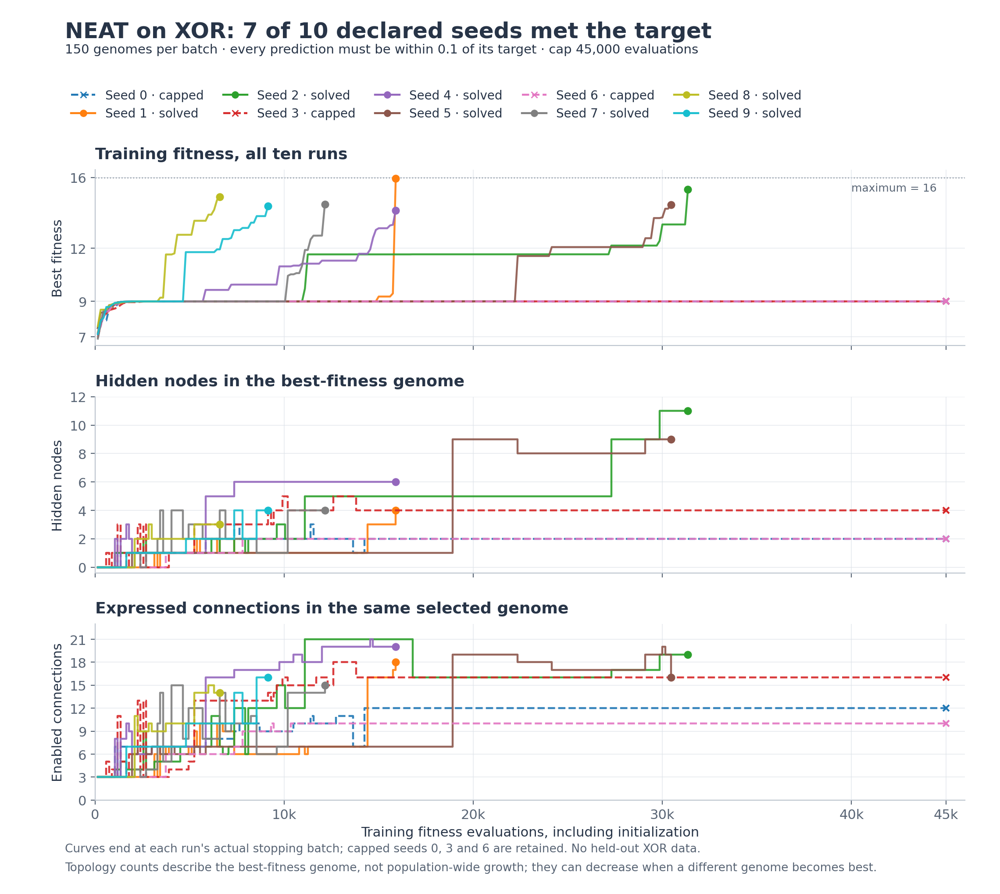
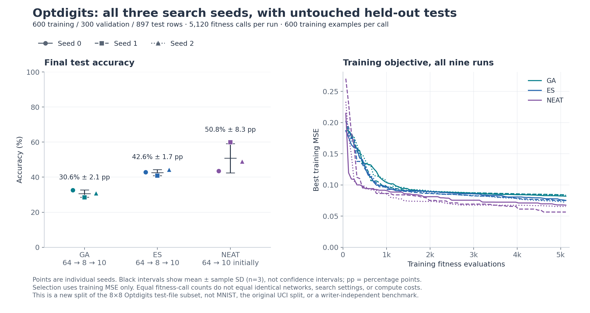
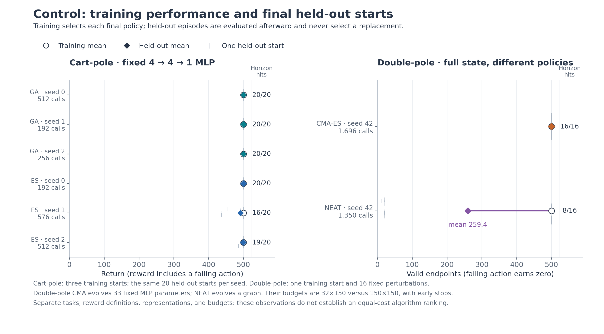
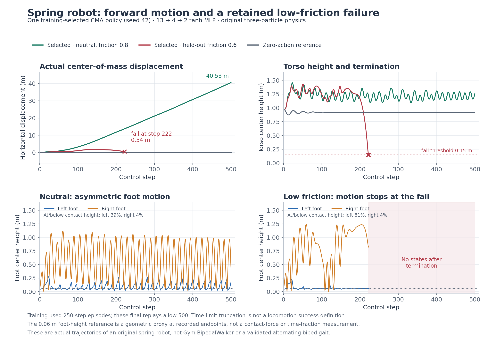

# Chapter 3: recorded experiments

These teaching experiments exercise the same **Generate → Evaluate → Select**
interface with fixed weights, seed lineages, and evolving graphs. They show useful
behavior and retained failures: feedforward NEAT solves XOR in 7 of 10 runs; a
double-pole policy that balances its training start fails half its held-out starts;
and the spring robot falls when ground friction is reduced. Different architectures,
fitness costs, and stopping rules prevent a general algorithm ranking. These are
original companion experiments, not reproductions of the book's cited papers.

Recorded on 2026-11-23 with Rust 1.85.1 on Linux x86_64. The CSVs are the source of
the figures and [summary.json](summary.json), which includes source hashes,
per-run values, and descriptive statistics. Sample standard deviations use
denominator *n − 1*; they are not confidence intervals. Single-seed experiments
do not estimate reliability across search seeds.

## 1. Evolving topology on XOR

The [protocol](neat_manifest.json) uses seeds 0–9, population 150, and at most 300
batches, including initialization: 45,000 fitness evaluations per seed. Fitness is
`(4 − sum_absolute_error)²`; success requires each of the four predictions to be
within 0.1 of its target. All four truth-table rows train the policy; there is no
held-out XOR set.



Seeds **1, 2, 4, 5, 7, 8, and 9** succeeded. Seeds **0, 3, and 6** reached the cap
with fitness 9 and MSE 0.25; their predictions and full curves remain in the data.
Among the seven successes, the median cost was **15,900 evaluations**, ranging
from 6,600 to 31,350. This median is conditional on success: the three capped
failures must not be assigned an invented solution time. Successful final genomes
have 3–11 hidden nodes. The plotted topology belongs to the best-fitness genome
observed so far; counts can decrease when a different genome becomes best.
See [runs](neat_xor_runs.csv), [predictions](neat_xor_predictions.csv), and the
saved [nodes](neat_xor_nodes.csv) and [connections](neat_xor_connections.csv).

## 2. A small handwritten-digit classification task

We normalize the 1,797 images in UCI's `optdigits.tes` by 16, then make a new
class-stratified split with seed 2026: 600 training, 300 validation, and 897 test
rows. This reuses the original test-file subset; it is neither the official UCI
split nor a writer-independent evaluation. Dataset provenance, licensing, and
hashes are recorded in [data/README.md](../../../data/README.md).

Each algorithm runs seeds 0, 1, and 2 for 80 batches of 64 candidates: **5,120
fitness calls**, each processing 600 training examples. Selection uses training
MSE; validation and test results are computed only after training. GA and the
self-adaptive isotropic ES use a fixed 64→8→10 network with 610 parameters;
NEAT starts with direct 64→10 connectivity. Their representations and settings
differ despite identical fitness-call budgets.

| Method | Test accuracy, mean ± sample SD | Individual seed range |
| --- | ---: | ---: |
| GA | 30.62% ± 2.07 percentage points | 28.43–32.55% |
| ES | 42.62% ± 1.74 percentage points | 40.80–44.26% |
| NEAT | 50.80% ± 8.30 percentage points | 43.59–59.87% |



These modest accuracies describe the declared small budgets and architectures,
not tuned classifier performance. Every seed, all three partitions, the exact
split, and configuration are available in [runs](digits_runs.csv),
[split assignments](digits_split.csv), and the [manifest](digits_manifest.json).

## 3. Training performance and control generalization



For **cart-pole**, GA and ES evolve the same 4→4→1 network on three training
starts. Search seeds are 0–2; population is 64, with a 60-batch cap and an early
stop at training mean return 500. Every run reaches that target, taking 192–576
fitness calls. Each call contains three episodes. The final GA policies reach the
500-step horizon on 60/60 policy–start pairs; ES reaches 55/60. ES's held-out mean
returns are 500, 491, and 499.3. The same 20 starts are reused for each policy,
so these are not 60 independently sampled starts. Cart-pole awards one point per
action, including a failing action. [Runs](cartpole_runs.csv),
[trials](cartpole_trials.csv), and the [protocol](cartpole_manifest.json) retain
these distinctions.

For **full-state double-pole**, seed 42 trains on one start and is tested on a fixed
16-start Cartesian product of cart offsets and pole angles. CMA-ES evolves a
6→4→1 network with 33 parameters; NEAT evolves a feedforward graph. Both have
150-batch caps, but populations are 32 and 150 respectively. Each fitness call is
one episode, and a failing action earns zero valid endpoints.

| Method | Training calls | Training valid steps | Held-out mean / minimum | Horizon hits |
| --- | ---: | ---: | ---: | ---: |
| CMA-ES | 1,696 | 500 | 500 / 500 | 16/16 |
| NEAT | 1,350 | 500 | 259.375 / 10 | 8/16 |

The NEAT result makes the training/generalization gap concrete. It is one search
seed with unequal budgets and representations, not evidence for a general
ordering of these algorithms. Held-out episodes never choose a replacement
policy. This full-state experiment does not test recurrence or historical
partial-observation protocols. See [runs](doublepole_runs.csv),
[trials](doublepole_trials.csv), and [manifest](doublepole_manifest.json).

## 4. An original spring robot

CMA-ES seed 42 optimizes a 13→4→2 controller for 100 batches of 32 candidates.
Each of 3,200 fitness calls averages three 250-step training episodes. Return is
horizontal center-of-mass displacement minus `0.002 × positive actuator work`
and a two-point fall penalty. The selected training mean return is 13.8334.



In an extended 500-step neutral replay, the selected policy moves **40.53 m** and
earns **35.35** return; the zero-action reference stays in place. Motion is strongly
asymmetric, with the left foot much nearer the ground than the right. The figure
reports foot heights, not a validated alternating gait or contact-force analysis.

Five of six one-at-a-time held-out perturbations reach the 500-step horizon. At
friction **0.6**, the robot falls at **step 222**, after **0.54 m**, for return
**−2.57**. The trajectory ends there. Horizon completion alone is not locomotion
success: the stationary baseline also survives. This is an original three-particle
spring model, not Gym BipedalWalker. [Runs](walker_runs.csv),
[trajectories](walker_trajectories.csv), and the [manifest](walker_manifest.json)
record all conditions, units, physics, and accounting.

## 5. Seed genomes and parallel evaluation

The mutation-only DeepGA teaching variant evolves a 609-parameter
2→16→16→16→1 XOR network with seed 42. Serial, Rayon with one worker, and Rayon
with four workers all stop at **2,304 evaluations**, with MSE **0.006776835**.
The example checks matching score bits, final seed genomes, decoded weight bits,
and evaluation counts across modes.

The selected genome holds one initial seed and 32 mutation seeds: **264 bytes of
seed payload**, versus **4,872 bytes of dense parameter payload**. This excludes
vector metadata, allocations, architecture/settings, issued copies, decoded
weights, and other state; it does not measure total memory savings. Decoding costs
`O(parameters × lineage length)` without a shared-prefix cache.

Recorded wall times are 0.660 s, 0.675 s, and 0.210 s respectively. These are one
local demonstration trial per mode, including search and curve logging, not a
controlled throughput benchmark. The executor parallelizes CPU jobs; this does
not demonstrate SIMD, GPU, or distributed execution. See [runs](parallel_runs.csv)
and [manifest](parallel_manifest.json).

## Reproduce the records and figures

From the repository root, the following reruns overwrite the corresponding
recorded outputs. The lockfile and manifests fix the supplied dependencies and
experiment settings; floating-point replay across architectures is not promised.

```sh
cargo run --locked --release -p nevo --example ch03_neat -- book/results/ch03
cargo run --locked --release -p nevo --example ch03_classification -- book/results/ch03
cargo run --locked --release -p nevo --example ch03_cartpole -- book/results/ch03
cargo run --locked --release -p nevo --example ch03_doublepole -- book/results/ch03
cargo run --locked --release -p nevo --example ch03_walker -- book/results/ch03
cargo run --locked --release -p nevo --example ch03_parallel --features parallel -- book/results/ch03
python scripts/plot_ch03.py
```

The [plotting script](../../../scripts/plot_ch03.py) needs Python 3.10+ and
Matplotlib (recorded with 3.10.8). It reads existing CSVs and writes four PNG/SVG
pairs plus the JSON summary; it does not run or tune optimizers. Use
`--output PATH` to write regenerated figures elsewhere. The scientific algorithms,
tasks, and experiment executables are Rust. Verification records are collected in
[validation/README.md](validation/README.md).
