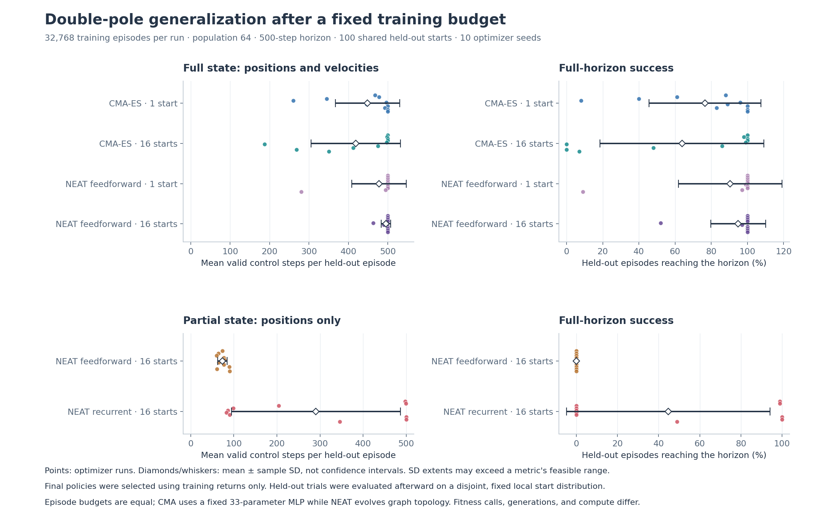
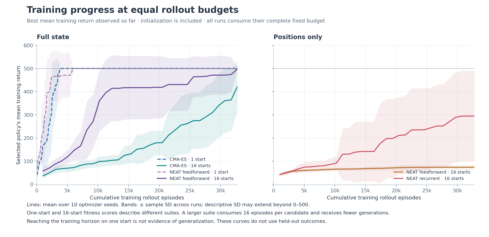
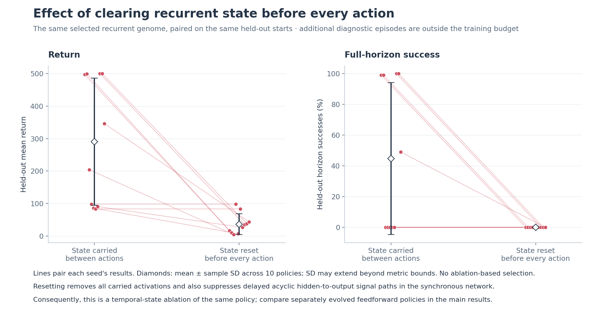
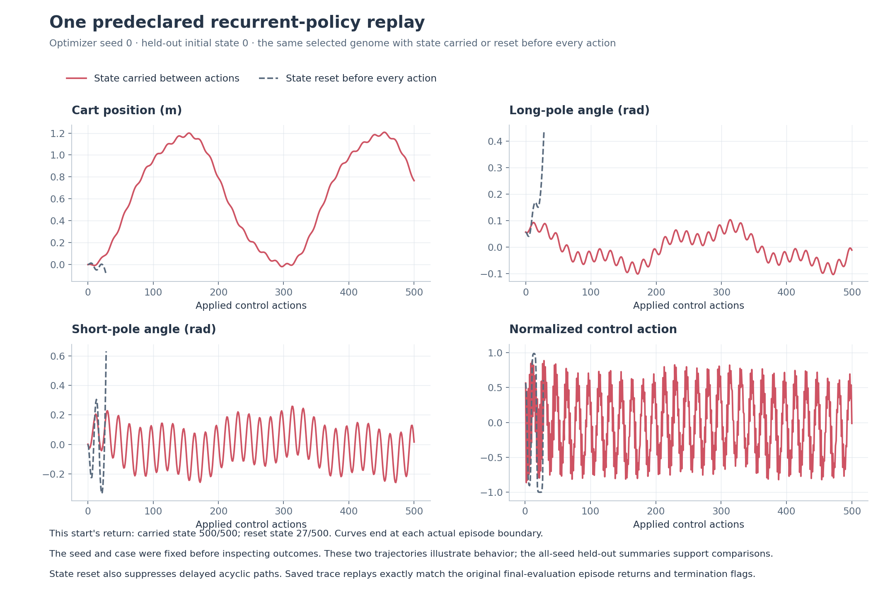
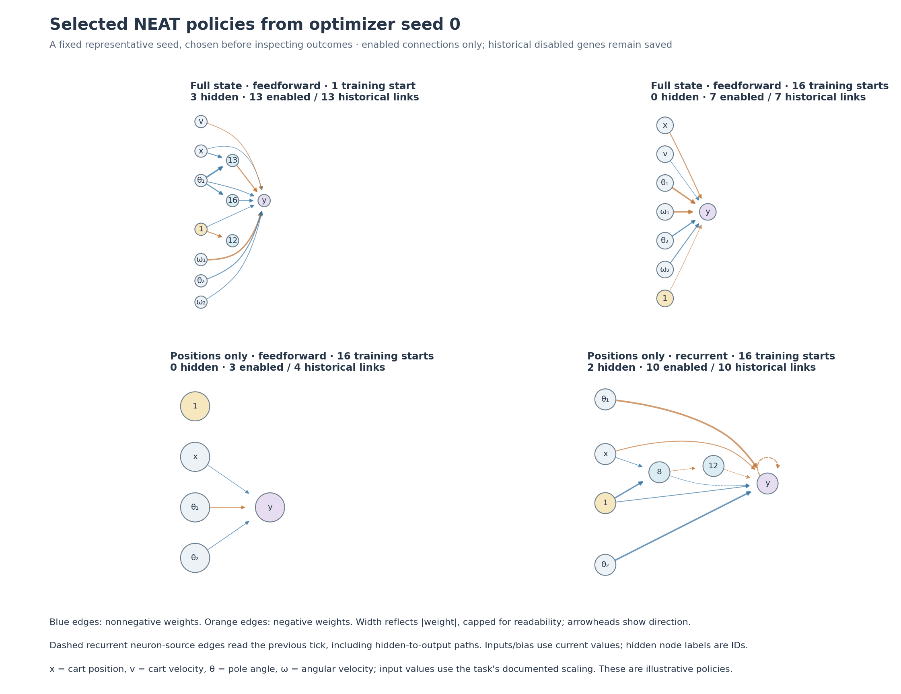
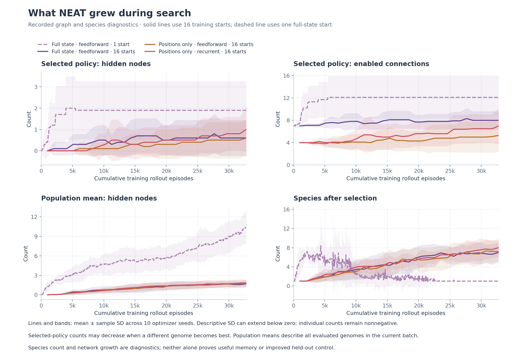

# Chapter 3 update: generalization and recurrent NEAT

**Executed 2026-11-25 with Rust 1.100.0.** All 60 declared runs completed.
This experiment studies the earlier double-pole generalization gap with repeated
optimizer seeds, explicit trial aggregation, equal training-episode budgets and
recurrent control. The [earlier single-start results](../ch03/README.md) remain
unchanged as a historical baseline.

The main finding is specific: **the original weak NEAT result did not establish
an algorithm ranking.** Full-state NEAT performs well on most seeds in this new
study. Training on 16 starts improves its average held-out result here, while
CMA-ES's average decreases under the same episode budget. Recurrence helps the
positions-only task substantially on average, but several seeds still fail.
The raw records include every run and every final test trial.

## 1. What was held fixed

| Setting | Full protocol |
| --- | --- |
| Optimizer seeds | Integers 0–9, all reported |
| Population | 64 for both CMA-ES and NEAT |
| Training budget | **32,768 rollout episodes per condition and seed** |
| Initialization | Included in the training budget as batch 1 |
| Stopping | Fixed budget; no early stop after a success |
| Single-start condition | 512 batches × 64 candidates × 1 episode |
| Multi-start condition | 32 batches × 64 candidates × 16 episodes |
| Training starts | The historical default, followed by 15 pseudorandom states drawn from one fixed training seed; the single-start condition uses the first |
| Held-out starts | One separate shared suite of 100 states, disjoint from training |
| Episode horizon | 500 actions, each representing 0.02 s |
| Training score | Mean number of physically valid control endpoints |
| Final controller | Highest mean training return actually observed; earliest exact tie |
| Held-out use | Evaluate the selected controller after search; never select, stop or tune on these results |

Each seed directory contains a complete `manifest.md` and `starts.csv` written
**before** optimization. Exact state values, RNG seeds and draw order are saved.
Both algorithms see the same suites. Different optimizer seeds do not create
new training or test suites.

The 15 random training states and 100 held-out states use separately seeded ChaCha8
generators, both using stream 4, with uniform coordinate bounds: cart position ±0.1 m, cart velocity
±0.02 m/s, long-pole angle ±0.07 rad, short-pole angle ±0.005 rad, long-pole
angular velocity ±0.02 rad/s and short-pole angular velocity ±0.05 rad/s. These
are **local initial conditions**. Success here does not establish recovery from
arbitrary states or robustness to changed physics.

CMA-ES uses a fixed 6 → 4 → 1 tanh/tanh MLP with 33 weights and biases,
initial mean sampled uniformly in ±0.5, initial sigma 0.5 and population 64.
NEAT starts with input/bias-to-output links, uses sigmoid outputs mapped to
force by `2*y-1`, and keeps its documented defaults except population and mode.
All resolved settings and physics parameters are in each manifest.

Equal episodes do not equalize fitness calls, actual actions or CPU work.
Representations, activations, initialization and search mechanisms also differ.
The comparison measures these declared algorithm/controller combinations; it
does not isolate the optimizer while holding a neural parameterization fixed.

## 2. Measured results

Every table entry averages **ten optimizer runs**. The ± value is sample standard
deviation across those ten run means, not a confidence interval and not the
standard error of 1,000 supposedly independent test samples. Each run reuses the
same 100 held-out starts. A horizon success reaches the time limit without
physical termination on the final action.

| Observations | Method | Training starts | Mean training return | Held-out mean return ± run SD | Mean horizon success |
| --- | --- | ---: | ---: | ---: | ---: |
| Full state | CMA-ES | 1 | 500.00 | **448.53 ± 81.25** | 76.5% |
| Full state | CMA-ES | 16 | 422.12 | **418.88 ± 113.62** | 63.8% |
| Full state | Feedforward NEAT | 1 | 500.00 | **477.44 ± 69.15** | 90.5% |
| Full state | Feedforward NEAT | 16 | 497.84 | **495.21 ± 11.85** | 94.9% |
| Positions only | Feedforward NEAT | 16 | 73.54 | **73.62 ± 10.95** | 0.0% |
| Positions only | Recurrent NEAT | 16 | 294.59 | **290.56 ± 196.21** | 44.7% |

Source: [runs.csv](runs.csv), [summary.csv](summary.csv) and
[summary.json](summary.json), independently checked against every raw trial.



### What these results say about the earlier NEAT outcome

The historical experiment used one optimizer seed, different populations,
early stopping and a 16-case test grid. Its NEAT controller achieved 8/16 test
horizons. This new study uses a different declared budget and test distribution;
it is not a rerun with only one variable changed.

Under the new protocol, full-state NEAT with one training start averages 90.5%
test success. With 16 starts it averages 94.9%, and run means are more tightly
clustered. There is still an important weak single-start seed: seed 9 reaches
only 9/100 horizons. The correct conclusion is that the previous plot described
one learned controller, not a general limitation of NEAT or Rust concurrency.

No default mutation rate, compatibility threshold or population setting was
tuned after viewing these results. The new recurrent mode did not change
feedforward random draws. The old experiment was regenerated with the updated
code and its **eight output files match exactly**; see
[the replay record](validation/doublepole_replay.json).

### Why a broader training suite is not a free improvement

Sixteen starts make each fitness call 16 times as expensive in episode count.
The fixed budget therefore allows only 32 generations instead of 512.
CMA-ES's 16-start training mean is still 422.12 at the budget limit; its learning
curve is consistent with incomplete optimization under this allocation.
Its held-out mean is lower than the one-start result here. The study does not
establish that more starts generally harms CMA-ES; a different budget or
allocation is a separate experiment requiring a fresh evaluation plan.

A single-start score also saturates at 500. Once a candidate reaches that score,
later equally scoring candidates cannot replace the historical winner under
the declared earliest-tie rule. Continuing search cannot distinguish their
generalization from that one score. This is a limitation of the fitness signal,
not evidence that all later candidates behave identically.



These curves use training data only. Bands are mean ± sample SD over ten runs.
Descriptive SD can extend beyond a bounded score range; it does not represent
an achievable individual observation or a probability interval.

## 3. What recurrence adds, and what remains difficult

The positions-only task hides all three velocities. Recurrent mode carries
hidden/output activations between control steps; feedforward mode has no neural
memory. The recurrent condition averages 290.56 valid steps versus 73.62 for
feedforward NEAT under the same population, training suite and episode budget.

That mean hides a substantial spread. Recurrent horizon successes for seeds
0 through 9 are:

**99, 99, 0, 0, 0, 0, 0, 100, 100, 49 out of 100.**

Five of ten recurrent runs never reach a held-out horizon. All ten feedforward
positions-only runs have zero horizon successes. These failures remain in the
plots, tables and saved controllers.

### Paired state-reset diagnostic

After final selection, the same recurrent genome is evaluated on the same 100
held-out states with memory cleared before every action. This consumes an
additional 100 episodes per recurrent run and does not alter its genotype.

| Evaluation of the same recurrent policies | Held-out mean return ± run SD | Mean horizon success |
| --- | ---: | ---: |
| State retained between actions | **290.56 ± 196.21** | **44.7%** |
| State reset before every action | **36.20 ± 32.04** | **0.0%** |

Reset lowers mean return in eight seeds and leaves it unchanged in two. The
paired mean retained-minus-reset difference is 254.36 steps. Maintaining
state materially affects many of these learned controllers.

This ablation removes **all previous-neuron signals**, including delayed
acyclic hidden-to-output paths. It measures dependence on persistent state
under our synchronous convention. It does not isolate cycle edges, and it does
not turn the same weights into an equivalent feedforward network. The separately
evolved feedforward condition supplies that distinct comparison.



For visual inspection, optimizer seed 0 and held-out case 0 were fixed before
looking at outcomes. The selected recurrent policy reaches 500 valid steps on
this case; the reset version reaches 27. This one illustration does not replace
the all-seed evidence above.



## 4. Inspect the evolved structure and the population

All final node/connection genes and weights are saved, including disabled
historical genes and the genotype's execution mode. The following figure shows
the predeclared seed-0 policies. Dashed neuron-source edges in recurrent mode
read the previous tick; the input and bias edges read current values.



The broader full-state NEAT condition often finds a small controller: its
selected policies have 0–2 hidden nodes, averaging 0.6. This local full-state
task can therefore succeed with little topology growth. The one-start condition
gets 16 times as many generations and ends with a much larger average evolving
population, even though its selected historical policy often froze earlier at
the score ceiling. Do not interpret population complexity as the complexity of
the saved champion.

`training.csv` records both champion and population complexity; `species.csv`
records species membership counts, fitness histories, stagnation and offspring
quotas after every selected batch. Counts and quota sums are validated.



Species counts and network growth are diagnostics. Neither metric alone proves
better generalization or useful memory.

## 5. Work accounting

| Work category | Fitness calls / policies | Episodes | Applied control actions |
| --- | ---: | ---: | ---: |
| Training, all 60 runs | 737,280 fitness calls | **1,966,080** | **262,852,364** |
| Final held-out evaluation | 60 selected policies | **6,000** | **2,206,535** |
| Recurrent state-reset diagnostic | 10 of those same selected policies | **1,000** | **37,198** |
| Predeclared trajectory replays | Six policies plus one reset variant | **7** | **2,595** |

Recorded training statistics come from the original fitness evaluations, without
rerunning candidates for logging. The trial summarizer aggregates recorded final
outcomes without calling policies again. A failed final action counts as work
even though its DoublePole reward is zero.

Runs were executed using **four concurrent independent seed processes**, with
serial evaluation inside each process. Total experiment wall time on this
machine was about 50.9 s; per-condition `seconds` includes setup, training,
policy writing, held-out evaluation, applicable ablations/replays and output
work before the final report. These timings are local execution records, not
isolated algorithm speed benchmarks or cross-machine performance guarantees.
See [experiment_execution.json](validation/experiment_execution.json).

## 6. Reproduce or extend

Run from the repository root with a new output directory:

```sh
cargo run -p nevo --example ch03_generalization --release --locked -- results/ch03_generalization
python scripts/plot_ch03_generalization.py --input results/ch03_generalization --output results/ch03_generalization
```

The plotting script requires Python, Matplotlib and Graphviz's `dot` executable.
It reads the Rust outputs, validates the complete declared experiment and creates
PNG/SVG figures plus summaries. It does not evolve or evaluate controllers.
The Rust experiment itself has no Python or Graphviz dependency.

`--seed 3` runs all six conditions for one optimizer seed; different seed
processes can write independently to the same output root. Existing seed
directories are not overwritten. Partial studies are not silently summarized
as the full ten-seed comparison.

For CI or a quick installation check:

```sh
cargo run -p nevo --example ch03_generalization --release --locked -- results/ch03_smoke --smoke
python scripts/plot_ch03_generalization.py --input results/ch03_smoke --output results/ch03_smoke --smoke
```

The smoke protocol has population 8, horizon 40, 256 training episodes per
condition and eight held-out starts. It checks integration only. Its output
must not be interpreted as evidence for the full study.

| Location | Contents |
| --- | --- |
| `seed_000/` … `seed_009/` | Exact configurations and shared initial states; per-run, per-batch, per-species and per-trial records |
| `seed_*/policies/` | Every final MLP or NEAT policy, with selected job ID and batch |
| `seed_000/traces.csv` | Seven predeclared trajectory replays, including the state-reset version |
| `runs.csv`, `summary.csv`, `summary.json` | Validated all-seed aggregates and descriptive statistical conventions |
| `*.png`, `*.svg` | Six reproducible figure sets |
| `validation/` | Rust checks, source review, exact historical replay, preservation checks and notebook execution |

The [executed Rust notebook](../../../notebooks/ch03_neuroevolution.ipynb)
demonstrates a hand-written recurrent circuit, a small live GES composition,
all-seed CSV analysis and a saved-controller replay. Its extra demonstration
episodes are separate from the work totals above.

## 7. Source and scope

The implementation follows the Chapter 3 topics in the supplied book PDF,
especially §§3.2–3.3, and the historical mechanisms in
[Stanley and Miikkulainen (2002)](https://nn.cs.utexas.edu/downloads/papers/stanley.ec02.pdf).
The synchronous recurrent convention has precedent in the
[NEAT-Python recurrent source](https://neat-python.readthedocs.io/en/latest/_modules/nn/recurrent.html).
The algorithms, data and experiment here remain independently implemented.

This study does **not** reproduce the original non-Markov oscillation penalty,
100,000-step qualification, 625-start historical generalization test or published
component ablations. It also does not implement the chapter's Box2D
BipedalWalkerHardcore task. Burn/Bevy backends, tensor batching, accelerator or
distributed execution are separate future work. See
[coverage](../../../coverage.md), [design](../../../DESIGN.md) and
[the independent review](validation/review.md) for the precise boundaries.
